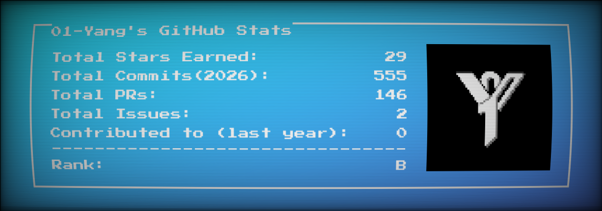
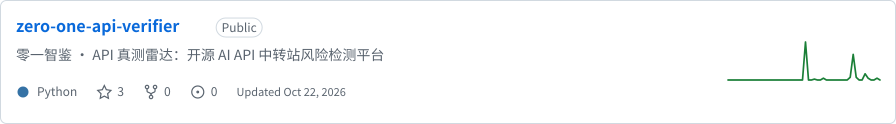
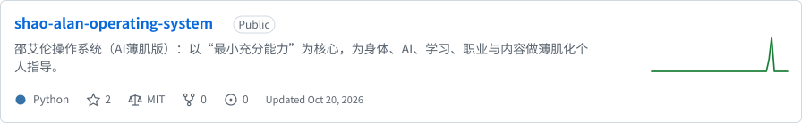
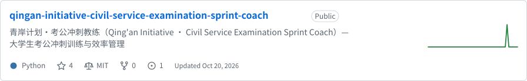

<!-- Generated automatically. Edit config/profile.json or scripts/generate.mjs instead. -->

# Hi, I'm 01Yang 👋

<strong>从零到一，让技术进步成为每个人的机会！</strong> 
<strong>From Zero to One, Turning Technology into Opportunity for Everyone！</strong>

 

  

### Repositories

<a href="https://github.com/XiaoSiKe/zero-one-api">
  <picture>
    <source media="(prefers-color-scheme: dark) and (max-width: 767px)" srcset="./assets/repositories/1-dark-mobile.svg">
    <source media="(max-width: 767px)" srcset="./assets/repositories/1-light-mobile.svg">
    <source media="(prefers-color-scheme: dark)" srcset="./assets/repositories/1-dark.svg">
    
  </picture>
</a>
<a href="https://github.com/XiaoSiKe/qingan-initiative-civil-service-examination-sprint-coach">
  <picture>
    <source media="(prefers-color-scheme: dark) and (max-width: 767px)" srcset="./assets/repositories/2-dark-mobile.svg">
    <source media="(max-width: 767px)" srcset="./assets/repositories/2-light-mobile.svg">
    <source media="(prefers-color-scheme: dark)" srcset="./assets/repositories/2-dark.svg">
    
  </picture>
</a>
<a href="https://github.com/XiaoSiKe/zero-one-api-verifier">
  <picture>
    <source media="(prefers-color-scheme: dark) and (max-width: 767px)" srcset="./assets/repositories/3-dark-mobile.svg">
    <source media="(max-width: 767px)" srcset="./assets/repositories/3-light-mobile.svg">
    <source media="(prefers-color-scheme: dark)" srcset="./assets/repositories/3-dark.svg">
    
  </picture>
</a>
<a href="https://github.com/XiaoSiKe/shao-alan-operating-system">
  <picture>
    <source media="(prefers-color-scheme: dark) and (max-width: 767px)" srcset="./assets/repositories/4-dark-mobile.svg">
    <source media="(max-width: 767px)" srcset="./assets/repositories/4-light-mobile.svg">
    <source media="(prefers-color-scheme: dark)" srcset="./assets/repositories/4-dark.svg">
    
  </picture>
</a>
<a href="https://github.com/XiaoSiKe/comfortable-ones-act-up-skill">
  <picture>
    <source media="(prefers-color-scheme: dark) and (max-width: 767px)" srcset="./assets/repositories/5-dark-mobile.svg">
    <source media="(max-width: 767px)" srcset="./assets/repositories/5-light-mobile.svg">
    <source media="(prefers-color-scheme: dark)" srcset="./assets/repositories/5-dark.svg">
    
  </picture>
</a>
<a href="https://github.com/XiaoSiKe/hengjian-hk-us-equity-research">
  <picture>
    <source media="(prefers-color-scheme: dark) and (max-width: 767px)" srcset="./assets/repositories/6-dark-mobile.svg">
    <source media="(max-width: 767px)" srcset="./assets/repositories/6-light-mobile.svg">
    <source media="(prefers-color-scheme: dark)" srcset="./assets/repositories/6-dark.svg">
    
  </picture>
</a>
<a href="https://github.com/XiaoSiKe/cet-sprint-coach">
  <picture>
    <source media="(prefers-color-scheme: dark) and (max-width: 767px)" srcset="./assets/repositories/7-dark-mobile.svg">
    <source media="(max-width: 767px)" srcset="./assets/repositories/7-light-mobile.svg">
    <source media="(prefers-color-scheme: dark)" srcset="./assets/repositories/7-dark.svg">
    
  </picture>
</a>
<a href="https://github.com/XiaoSiKe/01-ai-club-website">
  <picture>
    <source media="(prefers-color-scheme: dark) and (max-width: 767px)" srcset="./assets/repositories/8-dark-mobile.svg">
    <source media="(max-width: 767px)" srcset="./assets/repositories/8-light-mobile.svg">
    <source media="(prefers-color-scheme: dark)" srcset="./assets/repositories/8-dark.svg">
    
  </picture>
</a>

[View all repositories →](https://github.com/XiaoSiKe?tab=repositories)
