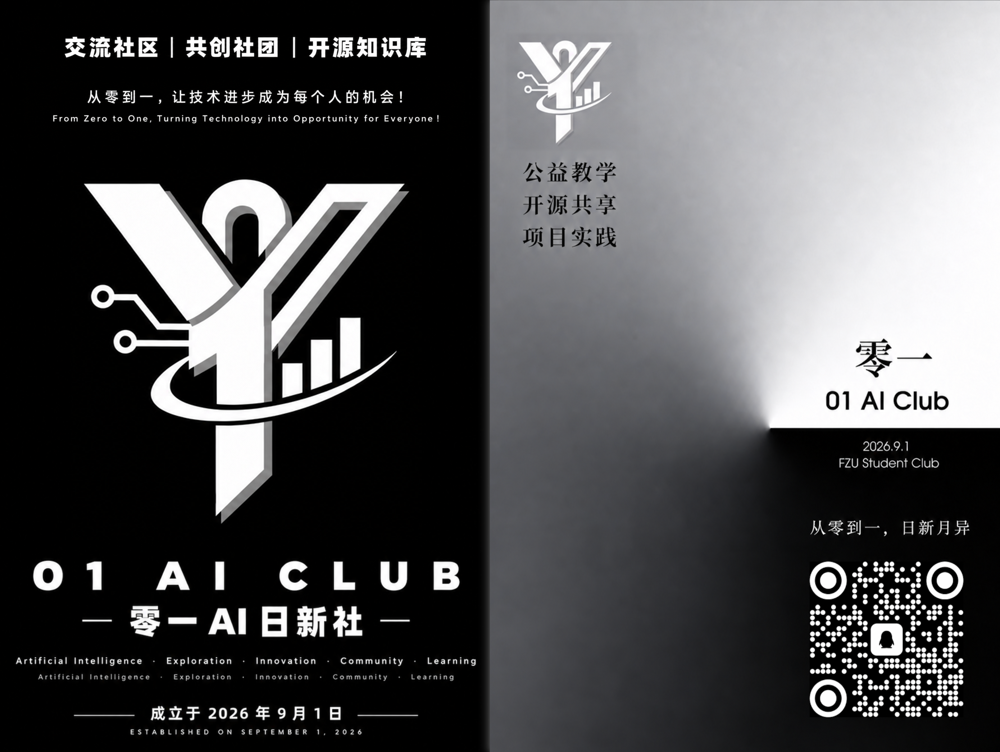

<!-- Generated automatically. Edit config/profile.json or config/introduction.md instead. -->

<h3><strong>从零到一，让技术进步成为每个人的机会！</strong> 
<strong>From Zero to One, Turning Technology into Opportunity for Everyone！</strong></h3>

**这里是「零一 AI 日新社｜01 AI Club」！**

> **一个立足福州大学、面向 AI 探索者的开源知识库、交流社区与学生社团。** 
> **「零一 AI 日新社」成立于 2026 年 9 月 1 日，我是社长，零一扬！**

**我们成立社团的初心，是探索一种能在真实世界中落地的“大学｜学习新范式”！** 
**从零到一，让技术进步成为每个人的机会！**

> **我们不把绩点和考试视为大学成长的全部，而是选择在实践中不断成长，不断进步。** 
> **我们以 公益教学 为核心，希望帮助每一位真正想学习 AI 的同学找到起点，** 
> **在交流与实践中迈出第一步，完成属于自己的从零到一！**

**如果你也认可这种长期主义的节奏，欢迎加入，一起把这件事做下去！**

> **我们相信，成长不必一蹴而就。** 
> **每天进步一点点，这便是“日新”的意义!** 
> **加入零一：[mp.weixin.qq.com](https://mp.weixin.qq.com/s/ffzU3C8Zd6vSgjZPq4j8UQ)**
>
> 
