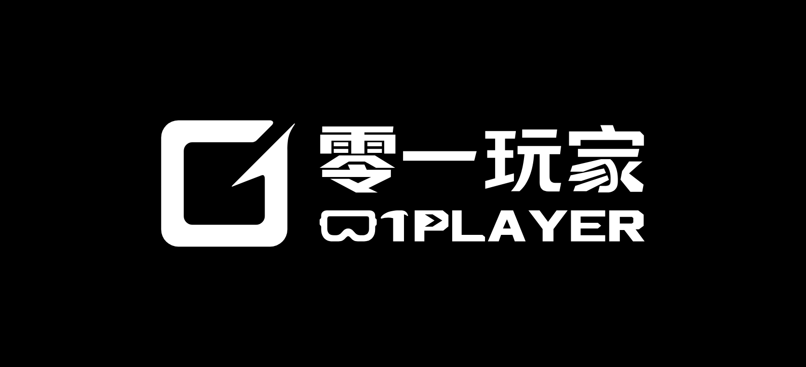
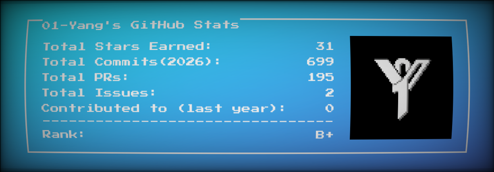

<!-- Generated automatically. Edit config/introduction.md to update the introduction. -->

**1、大家好，江湖人称“零一扬”，也可以叫我“扬子”。**\
**一个爱折腾的 AI 爱好者，一个爱思考的普通人，也是一个年少轻狂的大学生！**

**2、目前我主要在做些什么？**\
**「零一玩家智能科技」创始人兼CEO、创办与运营「零一玩家」AI 共创社区；**\
**开发「零一玩家 Shadow」、金融投资以及运营自媒体。**

**3、我的初心，「让技术进步成为每个人的机会」！**\
**所以，我创办了「零一玩家」！** **这是一个以大学生为主要群体、面向全社会开放的「AI 共创社区」！**\
**我们把现实生活看作一个开放的世界游戏：「地球Online：零一玩家」，每个人都是自己故事的主角！**\
**我们带着「玩家」的勇气与好奇心，在实践中不断探索与成长，完成自己的从零到一！**

 

  

### Repositories

<a href="https://github.com/XiaoSiKe/zero-one-api-verifier">
  <picture>
    <source media="(prefers-color-scheme: dark) and (max-width: 767px)" srcset="./assets/repositories/1-dark-mobile.svg">
    <source media="(max-width: 767px)" srcset="./assets/repositories/1-light-mobile.svg">
    <source media="(prefers-color-scheme: dark)" srcset="./assets/repositories/1-dark.svg">
    
  </picture>
</a>
<a href="https://github.com/XiaoSiKe/01-ai-club-website">
  <picture>
    <source media="(prefers-color-scheme: dark) and (max-width: 767px)" srcset="./assets/repositories/2-dark-mobile.svg">
    <source media="(max-width: 767px)" srcset="./assets/repositories/2-light-mobile.svg">
    <source media="(prefers-color-scheme: dark)" srcset="./assets/repositories/2-dark.svg">
    
  </picture>
</a>
<a href="https://github.com/XiaoSiKe/zero-one-api">
  <picture>
    <source media="(prefers-color-scheme: dark) and (max-width: 767px)" srcset="./assets/repositories/3-dark-mobile.svg">
    <source media="(max-width: 767px)" srcset="./assets/repositories/3-light-mobile.svg">
    <source media="(prefers-color-scheme: dark)" srcset="./assets/repositories/3-dark.svg">
    
  </picture>
</a>
<a href="https://github.com/XiaoSiKe/zero-one-orbit-intro">
  <picture>
    <source media="(prefers-color-scheme: dark) and (max-width: 767px)" srcset="./assets/repositories/4-dark-mobile.svg">
    <source media="(max-width: 767px)" srcset="./assets/repositories/4-light-mobile.svg">
    <source media="(prefers-color-scheme: dark)" srcset="./assets/repositories/4-dark.svg">
    
  </picture>
</a>
<a href="https://github.com/XiaoSiKe/01-lingguang-prologue">
  <picture>
    <source media="(prefers-color-scheme: dark) and (max-width: 767px)" srcset="./assets/repositories/5-dark-mobile.svg">
    <source media="(max-width: 767px)" srcset="./assets/repositories/5-light-mobile.svg">
    <source media="(prefers-color-scheme: dark)" srcset="./assets/repositories/5-dark.svg">
    
  </picture>
</a>
<a href="https://github.com/XiaoSiKe/zero-one-lingjie-theme">
  <picture>
    <source media="(prefers-color-scheme: dark) and (max-width: 767px)" srcset="./assets/repositories/6-dark-mobile.svg">
    <source media="(max-width: 767px)" srcset="./assets/repositories/6-light-mobile.svg">
    <source media="(prefers-color-scheme: dark)" srcset="./assets/repositories/6-dark.svg">
    
  </picture>
</a>
<a href="https://github.com/XiaoSiKe/lingyi-shiwen">
  <picture>
    <source media="(prefers-color-scheme: dark) and (max-width: 767px)" srcset="./assets/repositories/7-dark-mobile.svg">
    <source media="(max-width: 767px)" srcset="./assets/repositories/7-light-mobile.svg">
    <source media="(prefers-color-scheme: dark)" srcset="./assets/repositories/7-dark.svg">
    
  </picture>
</a>
<a href="https://github.com/XiaoSiKe/01-university-compass">
  <picture>
    <source media="(prefers-color-scheme: dark) and (max-width: 767px)" srcset="./assets/repositories/8-dark-mobile.svg">
    <source media="(max-width: 767px)" srcset="./assets/repositories/8-light-mobile.svg">
    <source media="(prefers-color-scheme: dark)" srcset="./assets/repositories/8-dark.svg">
    
  </picture>
</a>

[View all repositories →](https://github.com/XiaoSiKe?tab=repositories)
